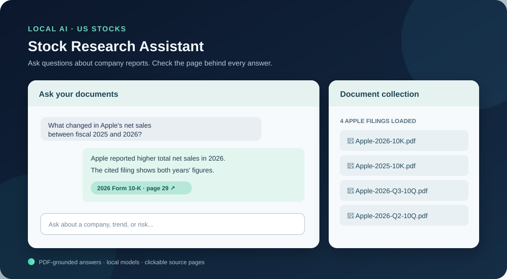
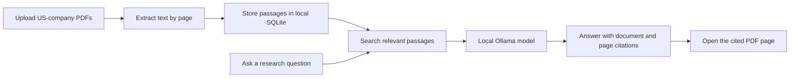

# 📈 Stock Research Assistant

### Source-backed research for US stocks, powered by local AI

> Upload company reports, ask what the evidence says, and open the exact PDF pages behind each answer.



*Interface overview. The working app runs locally on your computer.*

---

## 🌟 About the project

Stock Research Assistant is a local AI tool for **US-listed companies**. It helps a student compare company reports, examine risks, and identify evidence to watch before buying or selling a stock. You upload text-readable PDFs; the app searches them and explains relevant passages with clickable citations.

The first demo focuses on **Apple (AAPL)**. Its local collection contains four official filings: the 2026 and 2025 annual Forms 10-K and the 2026 second- and third-quarter Forms 10-Q. See [SOURCES.md](SOURCES.md) for the original PDF links.

## 🎯 Goal

Explore how a locally running language model can combine company-specific documents with a searchable knowledge base to support evidence-based stock research. A later extension can add a dated market snapshot and a saved financial news PDF. The current demo uses uploaded PDFs only; it does not fetch live prices or place trades.

## ✨ What the working app does

| Feature | What you can do |
| --- | --- |
| 📄 PDF collection | Upload and index reports or saved articles about a US company. |
| 💬 Natural-language questions | Ask about revenue, cash flow, risks, or evidence that could change an investment case. |
| 🔎 Local document search | Find relevant passages using embeddings plus keyword matching. |
| 🔗 Verifiable answers | See the document name and page number for each retrieved source. |
| 📖 Built-in PDF viewer | Open a cited page, browse other pages, or download the original PDF. |
| 🔒 Local processing | Keep uploaded PDFs and the search index on your own computer. |

## 💬 Example interaction

**Question:** What were Apple's total net sales in fiscal 2026 compared with fiscal 2025?

**Evidence to find:** Apple's 2026 Form 10-K reports $478,834 million for 2026 and $416,161 million for 2025 on PDF page 29. The assistant should point to that page so the reader can check the figures.

Other questions to try:

- What changed in revenue, margins, and cash flow between the latest annual report and the prior year?
- Which disclosed risks could weaken the investment case?
- What evidence in the uploaded documents would support buying, waiting, or selling?
- What information is missing, such as a current share price?

## 🧠 How it works



The Python server uses `pypdf` to read pages and `nomic-embed-text` through Ollama to index passages. Search combines vector similarity with keyword overlap. `qwen3:1.7b` receives the most relevant passages and writes an answer grounded in them. If embeddings are unavailable, keyword search still works.

## 🛠️ Tech stack

| Technology | Purpose |
| --- | --- |
| Python standard-library HTTP server | App and API |
| `pypdf` and `PyMuPDF` | PDF text and page handling |
| SQLite | Local documents and search index |
| Ollama + `qwen3:1.7b` | Local answer generation |
| Ollama + `nomic-embed-text` | Semantic search embeddings |
| HTML, CSS, JavaScript | Chat and PDF viewer interface |
| GitHub | Public code and project documentation |

## 📁 Repository layout

```text
Stock-research-assisstant/
├── app.py                    # Server, PDF indexing, search, and chat
├── web/                      # Chat interface and PDF page viewer
├── tests/                    # Focused app checks
├── download_sample_pdfs.py   # Load the four Apple sample filings
├── rebuild_embeddings.py     # Re-index an existing local collection
├── SOURCES.md                # Official links to the example PDFs
├── LAB_NOTES.md              # Assignment demonstration notes
├── requirements.txt
└── README.md
```

Uploaded PDFs and the SQLite index are stored in `data/` on your computer and are intentionally excluded from GitHub.

## 🚀 Run it locally

**Requirements:** Python 3.9 or newer and [Ollama](https://ollama.com/).

1. Install and start Ollama, then download the local models:

   ```sh
   ollama pull qwen3:1.7b
   ollama pull nomic-embed-text
   ```

2. In the repository folder, install the Python packages and start the app:

   ```sh
   python3 -m venv .venv
   .venv/bin/python -m pip install -r requirements.txt
   .venv/bin/python app.py
   ```

3. Open **http://127.0.0.1:8000**. Upload 4–5 text-readable PDFs about one company, or load the Apple starter collection in another terminal:

   ```sh
   .venv/bin/python download_sample_pdfs.py
   ```

   Indexing a large annual report may take several minutes. If you received the complete demo ZIP, four Apple filings are already loaded. If documents were uploaded before `nomic-embed-text` was installed, run `.venv/bin/python rebuild_embeddings.py`.

`PORT`, `OLLAMA_URL`, `CHAT_MODEL`, and `EMBED_MODEL` can be set as environment variables when needed.

## ✅ Project status and next steps

- [x] Build a local web app and PDF upload flow.
- [x] Index four official Apple filings.
- [x] Answer questions with named, clickable PDF-page sources.
- [x] Add an in-app viewer for cited pages.
- [x] Publish the working code on GitHub without the PDF collection.
- [ ] Extend the collection with a current, dated market source and a saved news PDF that may be used for this project.
- [ ] Compare the document evidence with a current share price before drawing any real investment conclusion.

## 🎓 Academic project

Built for the **Generative AI — AI with Local Knowledge** assignment. The lab demonstration and uploaded document list are in [LAB_NOTES.md](LAB_NOTES.md), and the four official PDF links are in [SOURCES.md](SOURCES.md).

The assistant is a research aid. It can miss context or make mistakes, so readers should check cited pages and current market information before making a financial decision.

---

### 📈 Stock Research Assistant — Evidence first, decisions informed.
